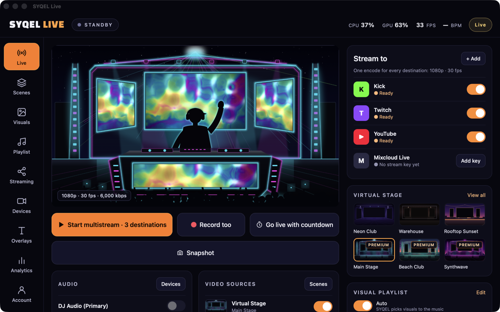

  

<h1 align="center">SYQEL Live</h1>

  <b>Stream your DJ set on a virtual stage, with visuals that move to your music.</b> 
  Webcam, stage and audio-reactive visuals in one app — live to every platform at once.

  
  
  

---

## What is SYQEL Live?

SYQEL Live puts you on a virtual stage for your live stream. Your webcam goes in the
middle, the stage's screens fill with visuals that react to the music you're playing,
and the whole show streams to Kick, Twitch, YouTube, Mixcloud and more — at the same
time, from one app.

It listens to your DJ software (or any audio on your computer), follows the beat, the
bass and the drums, and drives the visuals with them. No OBS scenes to wire up, no
virtual cables: pick a stage, turn on your camera, press **Start stream**.

## Features

### 📡 Go live everywhere
- **Multistream** to Kick, Twitch, YouTube, Mixcloud Live, Facebook Live, X, LinkedIn Live,
  Trovo or any custom RTMP server — all at once, from a single encode.
- **One-click connect** for Kick and Twitch — sign in and you're set, no stream keys to copy.
- **Record while you stream** (or record on its own) to an MP4 that stays playable even if
  the app quits mid-set.
- **Connection test** recommends the best quality your upload can carry.
- **Snapshot** saves exactly what your viewers see.

### 🎤 Your stage
- **12 virtual stages** — from a neon club and a rooftop at sunset to a festival main stage,
  a beach club, Neo Tokyo and the deep sea.
- **Webcam with background removal** — green screen for the cleanest edges, or automatic
  cut-out with no screen at all.
- **Layers and scenes** — arrange visuals, stage, webcam and your own images; save scenes
  and switch between them during your set.

### 🌈 Visuals that listen
- **Over 1,300 visuals** across 66 packs, plus generative 3D worlds — every one reacts to
  the kick, the bass and the hats, not just the volume.
- **Your own visuals** made in [SYQEL Studio](https://studio.syqel.com) sync straight in.
- **Playlists** mix worlds and visuals, with Cut, Fade, Zoom and Glitch transitions,
  shuffle and auto-play — or let SYQEL pick to the music.

### 🎛 Built for performing
- **Overlays** — Now Playing, DJ name tag, countdown, logo, sponsor and full-screen intro,
  each on a key (1–6).
- **Audio mixer** — your DJ audio, a talk-over mic and system audio, each with its own meter.
- **MIDI and hotkeys** for every action.
- **Venue output** — fullscreen on a projector or LED wall, **NDI®** to Resolume, OBS or
  vMix, **Syphon** (macOS) and **Spout** (Windows).
- **Stream analytics** — upload over time, destination health and a timeline of every
  stream, with export.

## Downloads

| Platform | Download |
|---|---|
| **macOS** (Apple Silicon + Intel, macOS 13+) | [download.syqel.com/live/mac](https://download.syqel.com/live/mac) |
| **Windows** (64-bit, Windows 10+) | [download.syqel.com/live/windows](https://download.syqel.com/live/windows) |

All installers are code-signed (and notarized on macOS). The downloads always point at
the newest release; older versions are on the [Releases](https://github.com/SYQEL/SYQEL-Live-Releases/releases) page.
The app checks for updates when it opens and installs them with one click — never mid-set.

## Free and paid

SYQEL Live is **free to use** — streaming, recording and every visual pack — on a choice of
virtual stages, with the SYQEL logo in the booth.

- **SYQEL Live** — **$25/month** or **$249/year**: no watermark on your stream, recordings and
  venue outputs, every layout and premium stage, your own logos, and 15 AI credits a month.
- **Gig Pass** — **$20** for 24 hours in SYQEL Live and SYQEL Desktop, no subscription.

## System requirements

- **macOS 13 Ventura or later** — Apple Silicon or Intel. macOS asks once for the camera,
  the microphone (for audio inputs) and Screen Recording (to hear system and app audio).
- **Windows 10 or later, 64-bit** — WebView2 (preinstalled on Windows 11; the installer
  handles it on Windows 10).
- A webcam, and about 7 Mbps of upload per 1080p destination. A discrete or modern
  integrated GPU is recommended for 1080p60.

## About this repository

This public repository hosts the **installers, release notes and update feed** for
SYQEL Live. Releases are built, signed and published here automatically.

- **Website:** [syqel.com](https://syqel.com)
- **All SYQEL apps:** [download.syqel.com](https://download.syqel.com)
- **Help & support:** [syqel.com/support](https://syqel.com/support) — or open an issue here
  for install or update problems with a release

---

NDI® is a registered trademark of Vizrt NDI AB. Syphon and Spout are open frameworks of their respective projects. Kick, Twitch, YouTube, Mixcloud and other service names are trademarks of their owners.

